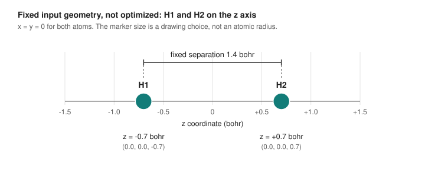

# H2-A-01 result report: one recorded RHF/STO-3G point

**Status.** Unpublished research note: an `[AGENT]` summary, prepared 2026-10-29, of one recorded software output and of
private task records. Method and scope: RHF/STO-3G at a fixed 1.4 bohr separation, one run, one point. It authorizes nothing and
makes no claim about any other calculation. Record: [results/h2/H2-A-01-run-01](../../../results/h2/H2-A-01-run-01/README.md).

<!-- pdf:begin summary -->
## 1. Summary and scope

One bounded attempt of job H2-A-01 ran once on 2026-10-29 through the route-R2 driver and ended with the driver tier
COMPLETED_PENDING_REVIEW. The engine (Psi4 1.11) reported a total energy of **-1.11671432506257 hartree** for the hydrogen
molecule at one fixed, input separation of **1.4 bohr**: RHF/STO-3G, two electrons, singlet, converged in 2 SCF iterations
(8.9037 s, exit 0). The 500 MiB memory figure was the engine's memory setting, not an operating-system memory cap. Locators, in the results record: `raw/result.json`; `redacted/psi4-output.dat` lines 153 to 155, 177 and
184; `redacted/driver-outcome.json`. The values are recorded engine output with `[COMP-PRED]` not assigned (section 7); the
settings are `[AGENT]` proposals as applied.

**What this is:** a single-point RHF/STO-3G number at one fixed separation, recorded from one run and narrowly reviewed.

**What this is not:** a dissociation curve; an optimized or predicted equilibrium bond length (1.4 bohr is the fixed input
internuclear distance, not a result); readiness for any further work; parity with any other calculation; a reproduction of,
or agreement with, the benchmark study; or validation of any donor, surface, pathway or diagnosis of the stopped E-01 attempt.

**Residuals** that this report states and does not resolve (sections 7 to 9): the engine's source-code identity is
unestablished and no `[COMP-PRED]` is granted; the `CURRENT ENERGY` alias is a `[GAP]`; OMP Warning #179 is INDETERMINATE
with its harmlessness unproved; and the Lead's disposition (section 7) records the reviewed-calculation requirement as not met.
<!-- pdf:end summary -->

<!-- pdf:begin fig3 -->
### Figure 3. Fixed input geometry

Figure 3. Fixed input geometry of H2-A-01: H1 and H2 on the z axis at -0.7 and +0.7 bohr. The 1.4 bohr internuclear distance
is the fixed input, not an optimized or predicted equilibrium bond length, and not a result. Source table and renderer: section 5
of the full report.
<!-- pdf:end fig3 -->

Files of Figure 3: renderer [tools/render_h2_input_geometry.py](../../../tools/render_h2_input_geometry.py); source table
[tools/h2-a01-input-geometry.tsv](../../../tools/h2-a01-input-geometry.tsv); PNG
[docs/figures/h2-a01-input-geometry.png](../../figures/h2-a01-input-geometry.png).

## 2. What was run

Source paths in the tables of this report are relative to the results record,
[results/h2/H2-A-01-run-01](../../../results/h2/H2-A-01-run-01/README.md), unless a link says otherwise.

| Item | As executed | Source | Label |
|---|---|---|---|
| Job and route | H2-A-01, Phase A, route R2 (prevention by a bound sandbox profile, without detection) | `redacted/launch-record.json` | driver record |
| Species | H2, neutral, singlet, 2 electrons, point group c1, centre of mass and orientation fixed | `redacted/i2-configuration.json` | `[AGENT]` setting, read back |
| Geometry | H1 (0.0, 0.0, -0.7) and H2 (0.0, 0.0, 0.7) bohr; fixed separation 1.4 bohr | `raw/result.json`; the input record | `[AGENT]` setting, read back |
| Method | RHF, STO-3G (2 basis functions) | `raw/result.json`; `redacted/i3-basis-geometry.json` | `[AGENT]` setting, read back |
| SCF options | DIRECT, guess CORE, DF_SCF_GUESS 0, E and D convergence 1e-08, MAXITER 50, FAIL_ON_MAXITER 1 | `raw/result.json` | `[AGENT]` setting, read back |
| Resources | 1 thread; engine memory setting 500 MiB (not an operating-system cap, M1); wall bound 300 s | `redacted/i2-configuration.json`; `redacted/launch-record.json` | `[AGENT]` settings |
| Engine | Psi4 1.11 in the supplied engine environment (Python 3.14.7, packaged by conda-forge, as the pre-import record shows) | `redacted/i1-identity.json`; `redacted/pre-import.json` | recorded |
| Platform | macOS 27.0.1, build 26A434 | `redacted/launch-record.json` | driver record |
| Code | repository commit `b8bbf237116b82e9479e9b7ac6e4b0138fba90cc`; eight covered files; no uncommitted difference recorded | `derived/code-provenance-summary.json` | driver record |

The settings are the `[AGENT]` proposals of the [method specification](h2-method-specification.md) and the
[parameter file](h2-method-parameters.json) as applied; the read-back confirms what the engine was given. It is not an
independent capability claim.

## 3. Recorded values

| Quantity | Value | Unit | Locator | Label |
|---|---|---|---|---|
| Reported total energy | -1.11671432506257 | Eh | `raw/result.json`; `psi4-output.dat` lines 177 and 184; `psi4-output.log` line 3 | recorded engine output; `[COMP-PRED]` not assigned |
| Reported nuclear repulsion | 0.7142857142857143 | Eh | `raw/result.json`; `psi4-output.dat` line 181 | recorded engine output |
| Electronic energy | -1.8310000393482843 | Eh | the independent review's derivation (section 4) | derivation, attributed; not printed by the engine |
| SCF iterations | 2 | | `raw/result.json`; `psi4-output.dat` lines 153 and 154 | recorded engine output |
| Convergence | true: no SCFConvergenceError with FAIL_ON_MAXITER set | | `raw/result.json` | recorded engine output |
| Process | exit 0; 8.903699540998787 s of a 300 s bound; not timed out | s | driver outcome (`redacted/driver-outcome.json`) | driver observation |

<!-- pdf:begin energy -->
## 4. What the reported total includes

The total energy that the engine returned **includes the nuclear repulsion** for this build. The independent review
established this from the engine's printed decomposition: the nuclear repulsion, the one-electron energy and the two-electron
energy sum to the printed total to 1e-16 hartree (`psi4-output.dat` lines 181 to 184). Under that convention, attributed to the
independent review, the electronic energy is the reported total minus the reported nuclear repulsion, -1.8310000393482843
hartree; it **includes the electron kinetic energy** (the lesson's convention, in its section "How the Hamiltonian splits") and the engine did not print it.
<!-- pdf:end energy -->

| Printed line | Value (Eh) | Locator |
|---|---|---|
| Nuclear Repulsion Energy | 0.7142857142857143 | `redacted/psi4-output.dat` line 181 |
| One-Electron Energy | -2.5055941236716519 | line 182 |
| Two-Electron Energy | 0.6745940843233675 | line 183 |
| Total Energy | -1.1167143250625700 | line 184 |

The four lines are quoted as printed, retained output, to show the convention; they are used for no further claim. The
lesson advises that when meeting any such number one first asks which quantity it is (section "Three energies, one curve").
Separately, the independent review checked that the reported nuclear repulsion equals 1/1.4 to within 1.43e-17 hartree; that
is a confirmation of units and geometry only.

## 5. Figures

All three figures are drawn from the exact source table beside each one, by a deterministic, standard-library renderer that
runs no engine and computes no chemistry. Each has an SVG, a 1440 px PNG export, a title, a description and alt text. Figure 3
is shown in section 1, beside the scope it illustrates; its source table is the first below.

Source table of Figure 3 (`tools/h2-a01-input-geometry.tsv`):

| Key | Value | Unit | Source |
|---|---|---|---|
| H1.x, H1.y | 0.0, 0.0 | bohr | `raw/result.json` read-back, atom 1 |
| H1.z | -0.7 | bohr | `raw/result.json` read-back, atom 1 |
| H2.x, H2.y | 0.0, 0.0 | bohr | `raw/result.json` read-back, atom 2 |
| H2.z | 0.7 | bohr | `raw/result.json` read-back, atom 2 |
| separation | 1.4 | bohr | the input record, `molecule.R_bohr`, a recorded setting |

<!-- pdf:begin fig4 -->
### Figure 4. SCF convergence, as printed

Figure 4. Panel A: the absolute value of the engine's printed, signed Delta E at SCF iterations 1 and 2, on a logarithmic axis;
taking the absolute value is a postprocessing transformation (only the minus sign was removed). The dashed line is the recorded
E_CONVERGENCE setting, a reference only. Panel B: the engine's own two rows, verbatim, with no iteration 0 and no other point;
the third column is the engine's `RMS \|[F,P]\|`, not a density change. Source table and renderer: section 5 of the full report.
<!-- pdf:end fig4 -->

Files of Figure 4: renderer [tools/render_h2_scf_rows.py](../../../tools/render_h2_scf_rows.py); source table
[tools/h2-a01-scf-rows.tsv](../../../tools/h2-a01-scf-rows.tsv); PNG
[docs/figures/h2-a01-scf-rows.png](../../figures/h2-a01-scf-rows.png).

Source table of Figure 4 (`tools/h2-a01-scf-rows.tsv`):

| Row | Label as printed | Total Energy | Delta E | `RMS \|[F,P]\|` | Trailer | Source |
|---|---|---|---|---|---|---|
| 1 | `@RHF iter   1:` | -1.11671432506257 | -1.11671e+00 | 1.56620e-16 | DIIS | `psi4-output.dat` line 153 |
| 2 | `@RHF iter   2:` | -1.11671432506257 | -4.44089e-16 | 1.56620e-16 | DIIS | `psi4-output.dat` line 154 |

The printed header is `Total Energy`, `Delta E`, `RMS \|[F,P]\|` (line 151). The guide line is the recorded
`E_CONVERGENCE` 1e-08 (`raw/result.json`, `post_energy_readback.options.e_convergence`). Delta E is quoted as printed and is
not recomputed from the rounded totals.

<!-- pdf:begin fig5 -->
### Figure 5. Signed energy components

Figure 5. Signed energy components of the recorded single point, in hartree, all anchored at zero on one axis, with
E_total = E_elec + Vnn. Vnn and E_total were reported by the engine (solid bars). E_elec is the independent review's
derivation under the convention that the reported total includes the nuclear repulsion (dashed outline): the engine did not
print it. Source table and renderer: section 5 of the full report.
<!-- pdf:end fig5 -->

Files of Figure 5: renderer [tools/render_h2_energy_components.py](../../../tools/render_h2_energy_components.py); source table
[tools/h2-a01-energy-components.tsv](../../../tools/h2-a01-energy-components.tsv); PNG
[docs/figures/h2-a01-energy-components.png](../../figures/h2-a01-energy-components.png).

Source table of Figure 5 (`tools/h2-a01-energy-components.tsv`):

| Component | Value (Eh) | Basis | Source |
|---|---|---|---|
| Vnn, nuclear repulsion | 0.7142857142857143 | engine-reported | `raw/result.json`; `psi4-output.dat` line 181 |
| E_elec, electronic energy | -1.8310000393482843 | the independent review's derivation | reported total minus reported nuclear repulsion, for this build |
| E_total, total energy | -1.11671432506257 | engine-reported | `raw/result.json`; `psi4-output.dat` line 177 |

## 6. Process, checks and host

- **Process.** One invocation of the driver's `run` mode, one engine process; exit 0; 8.903699540998787 s; not timed out;
  no process left in the group. The peak child resident size, 174800896, is recorded in a platform-defined unit and is an
  observation only.
- **Checks.** The driver's preflight inside the invocation passed 34 of 34 checks, the final block 35 of 35 (it replaces the
  attempt-absent check by a fresh-attempt check and adds `r2.attempt.bundle_fresh`), and the post-run block 33 of 33 (neither
  attempt check). The base check `network.prerequisite`, which the approved route-R2 revision replaces, is retained as a FAIL
  with detail `NETWORK_PREREQUISITE_UNRESOLVED` in all three blocks. It is not relabelled, and no claim about network
  traffic is made.
- **Engine streams.** Standard output: `Threads set to 1 by Python driver.` and `Memory set to 500.000 MiB by Python
  driver.` Standard error: one line, `OMP: Warning #179: Function Can't set size of /tmp file failed:` (section 9).
- **Host, after the run.** A read-only capture about 57 min 32 s after launch, not made by the driver: arm64, Apple M5 Pro,
  18 CPUs in two core levels of 6 and 12 (the performance and efficiency labels are an inference, not in the capture),
  68719476736 bytes of memory, model Mac17,9, macOS 27.0.1 build 26A434, Darwin 27.0.0, last boot 2026-10-06T01:53:17Z.
  Supported by the retained capture: the OS product and build equal the launch record's, the last boot precedes the launch,
  the hardware numbers, and the host name (which agrees with the engine's own output; it is not published). Same host is
  supported but not unique: no serial number or hardware UUID was captured, and the numbers match the host after the run
  only. **Supplied and unverified:** that the recorded `sandbox-exec` digest equals the installed program's digest at
  capture time, and that the recorded absolute paths existed then; the retained capture holds no hash or path check.
  Exclusivity of the capture is indeterminate. Load, thermal state and memory pressure at run time are **UNOBSERVED**.

<!-- pdf:begin review -->
## 7. Review, chronology and classification

Chronology, 2026-10-29, nothing rewritten: an independent review of the run result recorded APPROVE, and the Lead accepted
the narrow result; a review of the material behind a later host-capture summary recorded **REJECT** with one blocker (two
checks the retained capture does not contain), which stays on the record; a documentary erratum relabelled those claims supplied
and unverified, and a further review recorded APPROVE; a final review recorded APPROVE, and the Lead's disposition records the
orchestration run-record requirement as **met on a retained supplied-source basis only** (its external files and store digests
were supplied, not independently authenticated) and the reviewed-calculation requirement as **not met**, because the engine's
source-code identity is unestablished. The step-by-step chronology is in the full report.

**Classification.** The values are actual software output of one engine run. `[COMP-PRED]` is **not granted**: the evidence policy
(section 4) requires complete provenance, and the remaining gap is the engine's source-code identity (section 8). The
classification belongs to the independent review and Lead acceptance, recorded privately.
<!-- pdf:end review -->

Step-by-step chronology (full report only):
1. The run completed. An independent review of the run result recorded APPROVE with eight non-blocking findings and no
   blocker, and Lead acceptance of the narrow result is recorded (private task records).
2. A read-only host capture was taken about 57 min 32 s after launch, and a summary of it was written.
3. An independent review of the material supporting that summary recorded **REJECT** with one blocker: the summary stated, in
   the present tense, two checks (that the recorded `sandbox-exec` digest equals the installed program's, and that the
   recorded absolute paths exist) that the retained capture does not contain. The REJECT stays on the record, and the Lead
   did not accept that candidate.
4. A documentary erratum, with no new capture and no probe, relabelled those two claims supplied and unverified. A further
   independent review recorded APPROVE with eight non-blocking findings, and the Lead accepted the correction. That acceptance
   covers the correction only: it closes no open item and grants no evidence class.
5. A final independent review recorded APPROVE with eight non-blocking findings, and the Lead's disposition records two
   outcomes. The orchestration system's own run-record requirement for this attempt is **met on the retained supplied-source
   basis only**: the tuple of the authorization, Mission, revision, proposal and workspace identifiers matches, and the result
   and its full review are bound and durable, but the external files and whole-store digests were supplied and are not
   independently checked or authenticated as to current state. The reviewed-calculation requirement is **not met**: its
   provenance clause stays open on the engine's source-code identity, and no `[COMP-PRED]` is granted.

<!-- pdf:begin engine -->
## 8. Engine source-code identity: the remaining evidence-policy gap

The engine is the conda-forge psi4 1.11 build `py314h53d0584_1` (archive SHA256
`92d4aeb73fe7027bd239a656cf353461490420d76096ae762bd9f1c29ed4da10`). The code-provenance record excludes the engine environment; the engine prints the build's placeholder revision, `Git: Rev {} zzzzzzz`
(`redacted/psi4-output.dat` line 6). **Source-to-binary correspondence is not established** and no `[COMP-PRED]` is granted; the
catalogue ([docs/SOURCES.md](../../SOURCES.md) [31], [37], [52], [53], [54], quoted in the full report) records that the material
this project holds cannot establish it.

Two anomalies are explained by **supplied** evidence, a read-only observation of the external engine environment made outside
this project's boundary: the installed core extension differs from its archive path record because conda applied its declared
prefix replacement and re-signed it ad hoc, matching conda's own install-time record; and the banner revision is the shipped
version metadata's placeholder. This shows no tampering or different build, an absence of evidence and not a proved negative;
the patch and re-signing were not reproduced byte for byte.

The run's own identity record lists 468 loaded images, including `libint2.dylib` at the engine prefix, a runtime observation; a path is not a build identity and the load name encodes no version (compatibility version 0.0.0 in the supplied static check), so the loaded build, version and source linkage stay unresolved.
<!-- pdf:end engine -->

Detail of the engine-identity gap (full report only):
- The code-provenance record's coverage statement excludes the engine environment, which is bound only by file digests
  (`derived/code-provenance-summary.json`, `coverage.not_covered`).
- The package recipe declares `1.11+zzzzzzz` as "a version placeholder, not an upstream commit identifier"
  ([docs/ms-001/RECIPE-METADATA-AUDIT.md](../../ms-001/RECIPE-METADATA-AUDIT.md), section 2, the paragraph after its table).
- The catalogue: [52]: "Compiled code cannot be compared with source by hash." [53]: a path record "does not show ... what a
  binary was compiled from". [54]: static installed bytes are "not source-to-binary correspondence", and "The core extension
  differs from its archive path record [53]. The reason is not established." (the supplied evidence above explains the
  difference; it does not establish source identity). [37]: "actual build/source correspondence ... remain open". [31]: "the
  build provenance of the installed Psi4" remains open.
- The recipe-declared source archive and the project's commit-addressed archive of tag `v1.11` differ in digest and were never
  compared (RECIPE-METADATA-AUDIT.md, section 2, the paragraph after its table). No record ties the core extension to the `v1.11` tag commit,
  the build records no git hash, compiler inputs and build logs are not held, and the conda-forge CI build record is outside
  this project's boundary and was not fetched.
- The recorded core-extension digest (`0d12c8cda49e2cfe75cea563a2fe51889fa61b88c7b5234beb165b9b54805d99`) matches the one in
  E-01's [method-config.json](../../../results/e01/method-config.json), under the key `lib/python3.14/site-packages/psi4/core.cpython-314-darwin.so`. That is one digest agreeing between two
  records. It does not establish that the builds are the same build, that the runtimes were equivalent, or that
  source-to-binary correspondence holds.
- The supplied observation is a private record (SHA256 `b57a92c9c83d5748718cd474b12affc9eea2778a6574bf1bdc13d90eb2712728`);
  the earlier assessment of this gap (SHA256 `093a4c5dc2c048c5c2adaef7d214b99865b78748b90dd7dc16fffe61aab9a4b3`) stays as the
  historical record, and a later supplement (SHA256 `b263e22ca676fb6c06122973ef0beee5789d19534719a6c9fc659ebbe4e71d4a`)
  carries what changed.

Source-to-binary correspondence stays UNESTABLISHED, and no `[COMP-PRED]` is granted.

<!-- pdf:begin residuals -->
## 9. Open items and residuals

- **The returned-energy alias is a GAP.** For `CURRENT ENERGY`, the payload's source text is a literal string at line 445 of [the payload](phase-a/h2_phase_a_payload.py) at the base commit, not a read-back. The returned, printed-final and printed-total energies agree (`psi4-output.dat` lines 177 and 184; `psi4-output.log` line 3), but the label is not independently proved.
- **OMP Warning #179, INDETERMINATE.** `raw/engine.stderr` line 1 reports a file-sizing failure; its cause and numerical impact are unknown, its harmlessness is unproved, and convergence does not prove it harmless.
- **The Lead's disposition (section 7).** The result has not been ingested into the orchestration system (the approved text does
  not require it) and this report does not claim it. The reviewed-calculation requirement is **not met**: its provenance clause
  is open on the engine's source-code identity (section 8).
- Also open: the `network.prerequisite` FAIL; host provenance (section 6); P1, loaded identity, the Libint load-name question, E1, profile compatibility; M1; retention and execution completeness; Phase B NOT_RUN; E-01 unexplained.
<!-- pdf:end residuals -->

The list above is the brief form; the full table of open items follows.

| Item | Status | Note |
|---|---|---|
| OMP Warning #179 | INDETERMINATE | Text in `raw/engine.stderr` line 1. It reports a file-sizing failure. Cause and numerical impact are unknown; harmlessness is unproved; convergence does not prove it harmless. |
| `CURRENT ENERGY` alias | `[GAP]` | The payload's recorded source text for the returned value is a literal string at line 445 of [the payload](phase-a/h2_phase_a_payload.py) at the base commit, not a read-back. The returned, printed-final and printed-total energies agree (`psi4-output.dat` lines 177 and 184; `psi4-output.log` line 3). |
| Engine source-code identity | UNESTABLISHED | Section 8. No `[COMP-PRED]`. |
| `network.prerequisite` | FAIL, retained | Retained in all three check blocks; prevention by the sandbox profile, without detection; no traffic claim. |
| Platform-added environment name | recorded, not interpreted | `__CF_USER_TEXT_ENCODING`, listed by the launch record as added by the platform (E1 stays open). |
| Host provenance | incompletely verified | Section 6: supported items, supplied and unverified items, not unique, load UNOBSERVED. |
| P1, loaded identity, the Libint load-name question, E1, profile compatibility, source-to-binary correspondence | OPEN | The identity record lists the loaded images (among them `libint2.dylib` and `libxc.15.dylib` under the engine prefix); recorded, not interpreted. |
| M1 | accepted, not resolved | 500 MiB is an engine setting, not an operating-system memory limit. |
| Retention and execution completeness | INDETERMINATE | |
| Phase B | NOT_RUN | No authorization. |
| E-01 | unexplained | Technically BLOCKED and scientifically INDETERMINATE. W1 STOPPED (S10); C3 readiness, Stage 1 and option A BLOCKED. |

<!-- pdf:begin science -->
## 10. Research connection and a conceptual question

**Why a two-electron calculation is in this repository.** The research aims at a reviewed, reproducible computational capability
for mechanically controlled chemistry, starting with engine and method validation on well-defined species before any tool-surface
model is attempted ([.agents/RESEARCH-STATE.md](../../../.agents/RESEARCH-STATE.md), section 1; [README.md](../../../README.md),
opening paragraph). The chemistry in view is the benchmark's carbon donation from a germanium-based tool to a hydrogen-passivated
silicon surface ([docs/benchmark.md](../../benchmark.md), "Experimental setup"). The hydrogen molecule is the smallest case showing every step of such a calculation ([docs/learning/h2/README.md](README.md), opening paragraph).

**What the calculation does.** The nuclei are held fixed, a computational choice and not a claim that they are classical, so the
electrons form a problem that depends on the positions only as a parameter ([lesson](lesson-01-fixed-separation-scf.md), "Why the
nuclei are held fixed", citing SOURCES [45]). The program improves the orbitals by repetition (lesson, "What SCF varies", citing
[48]); "converged" means only that the reported criteria fell below their thresholds, not that the result is a minimum or the best
answer (lesson, "Convergence is not a minimum"); here two iterations sufficed (Figure 4). RHF is a single determinant and STO-3G
gives two basis functions, so the number depends on both and on the distance chosen as input (lesson, "What RHF and a finite basis
leave out" and "Single point, scan, and optimization"). The total includes the nuclear repulsion and the electronic term includes
the electron kinetic energy (section 4).

**The shared bookkeeping.** The run exercised, at tiny scale, the provenance that the evidence policy asks of any result ([docs/evidence-policy.md](../../evidence-policy.md), section 4), and showed where it falls short (section 8).

**What this is not.** It is a tiny two-electron learning calculation. There is **no converged donor result**, and the coupled tool-surface route is **not demonstrated** ([AGENTS.md](../../../AGENTS.md), "Claims that require reviewed evidence", bullet "Coupling"). E-01, the attempt aimed at the donors, did run a precursor and stopped during integral
setup; it is closed as technically blocked and scientifically indeterminate, its cause was never diagnosed, and it is retained
([results/e01/README.md](../../../results/e01/README.md), opening paragraph). The donor and surface models are unoptimized definitions (RESEARCH-STATE.md, section 3), and the donor, surface and coupling work remains unvalidated.

**A conceptual question.** This number depends on a basis set, an electronic model, a fixed distance and an engine whose source
identity is not established. For a calculation on the donor, which of those dependencies would a reader most need to be able to
check from the record alone, and what would that check consist of?
<!-- pdf:end science -->

Note on E-01 (full report only): the recorded core-extension digest matches the one in E-01's
[method-config.json](../../../results/e01/method-config.json), under the key `lib/python3.14/site-packages/psi4/core.cpython-314-darwin.so`; that is one digest agreeing between two records, and it
does not establish the same build, equivalent runtimes or source-to-binary correspondence. E-01 used the conventional (PK)
algorithm ([results/e01/README.md](../../../results/e01/README.md), section 1, "What was run") and this run used DIRECT, so this run says nothing
about why E-01 stopped.

## 11. What this does not show

- It is a single point at one fixed separation. No other separation, method or basis was calculated, so it gives no
  dissociation curve and no minimum.
- The 1.4 bohr separation was chosen as an input. It is not an optimized or predicted equilibrium bond length and not an
  optimized geometry.
- It is not readiness, and not parity with any other calculation. It is not a reproduction of, or agreement with, the
  benchmark study, and it validates no donor, surface, mechanism or pathway.
- It does not explain E-01, which ran, stopped during integral setup and is retained as technically blocked and scientifically
  indeterminate, and it does not close any open item above.

## 12. Provenance, files and sources

- **Authorization.** One bounded attempt, authorized by the project owner on 2026-10-29 (recorded on receipt at 20:19:15Z;
  not an independently measured time of the decision; the identity of the person was not independently established). The
  authorization of 2026-10-10 stays unexercised and is not carried forward
  ([stop record](../../../results/h2/H2-A-01/README.md)). It authorizes nothing further: no second attempt, no Phase B.
- **Run window.** 2026-10-29T20:39:49Z to 20:39:58Z; the energy call ran from 20:39:58.12 to 20:39:58.15.
- **Records.** [results/h2/H2-A-01-run-01](../../../results/h2/H2-A-01-run-01/README.md): its `outcome.json`,
  `provenance.json` (a hashed inventory of all sixteen original files, the public derivatives, the redaction rules and
  counts), the verbatim copies in `raw/`, the redacted copies in `redacted/` and the summary in `derived/`. All originals stay
  private and unedited.
- **Figures and tools.** [docs/figures/](../../figures/) holds `h2-a01-input-geometry`, `h2-a01-scf-rows` and
  `h2-a01-energy-components`, each as `.svg` and `.png`; [tools/](../../../tools/) holds the three renderers, their three
  source tables, the PNG exporter and the PDF builder.
- **The PDF.** [H2-A-01-RESULT-REPORT.pdf](H2-A-01-RESULT-REPORT.pdf) is a derived summary of this report: selected blocks of
  it, in its own wording, with no statement that is not in this report. It carries the SHA256 of this file, which is listed
  in [provenance/EXPORT-MANIFEST.md](../../../provenance/EXPORT-MANIFEST.md).
- **Locators.** A citation by line number into a file that this change does not edit refers to that file at the base commit
  `b8bbf237116b82e9479e9b7ac6e4b0138fba90cc`, where it is stated. The files that this change edits (`README.md`, `AGENTS.md`,
  `.agents/RESEARCH-STATE.md`, `docs/SOURCES.md` and `docs/learning/h2/README.md`) are cited by section or entry, never by line.
  Line numbers into the results record, which is new, are stable.
- **Sources.** [docs/SOURCES.md](../../SOURCES.md) entries [60] to [62]; earlier H2 entries [45] to [59]; the
  [evidence policy](../../evidence-policy.md); the [lesson](lesson-01-fixed-separation-scf.md). Every file is listed with its
  SHA256 in [provenance/EXPORT-MANIFEST.md](../../../provenance/EXPORT-MANIFEST.md).
